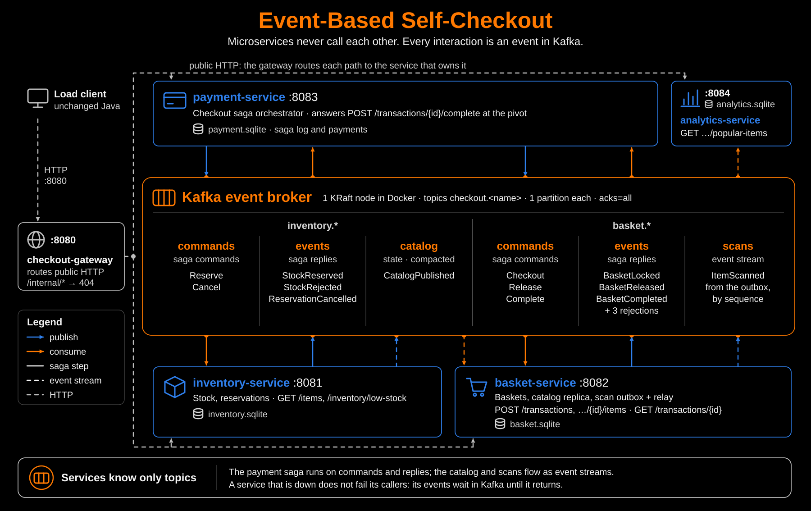
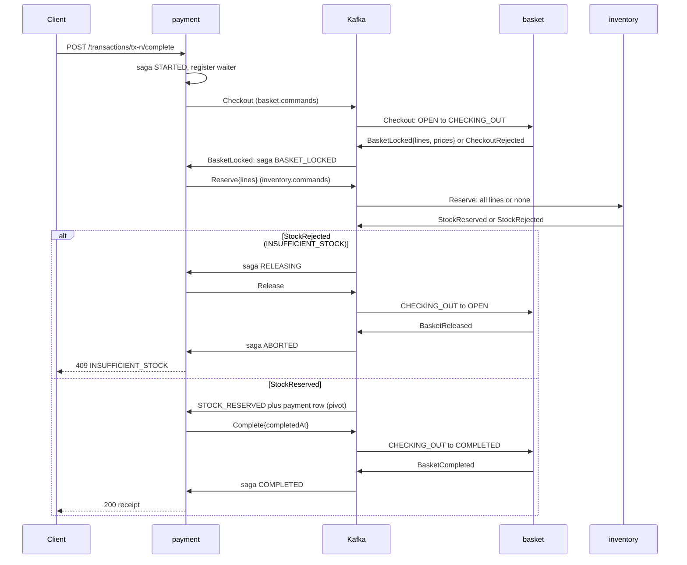

# Assignment 6 — Self-Checkout: Event-based microservices (Kafka)

The Assignment 5 microservices now communicate **only through events**. All
service-to-service traffic goes through an **Apache Kafka** broker:

- the checkout saga;
- the catalog replica;
- the scan feed for analytics.

No service calls another service over HTTP, and no service knows another's
address. Each service still runs as its own Rust binary with its own private
SQLite database. The routing-only API gateway still forwards the unchanged
load client's HTTP requests to the service that owns each public route.

Submission directory: <https://github.com/SASUKE40/CS6510-2026/tree/main/event-based>

## Deliverables

- Load test with default parameters (10 stations, 60 s):
  [`reports/default/report-20261026-193649.json`](reports/default/report-20261026-193649.json)
- Load test in stress mode (`java -cp out Main --stations=100 --duration=120`):
  [`reports/stress/report-20261026-193904.json`](reports/stress/report-20261026-193904.json)
- Architecture diagram showing the microservices and the event broker:
  [`architecture.svg`](architecture.svg) ([PNG](architecture.png), Mermaid
  text version in [`architecture.mmd`](architecture.mmd)).

Each report directory also contains:

- `verification.txt`: cross-database and Kafka invariant checks on the stopped system;
- `failures.txt`: an accounting of every client error;
- `logs/`: one log per process.

`sequential-consumers/` holds the comparison run described in
[Results](#results-and-comparison).

## Architecture



| Microservice | Port | Owns | Public routes (via gateway) | Publishes | Consumes |
| --- | --- | --- | --- | --- | --- |
| `inventory-service` | 8081 | `inventory.sqlite` | `GET /items`, `GET /inventory/low-stock` | `inventory.catalog`, `inventory.events` | `inventory.commands` |
| `basket-service` | 8082 | `basket.sqlite` | `POST /transactions`, `POST /transactions/{id}/items`, `GET /transactions/{id}` | `basket.events`, `basket.scans` | `basket.commands`, `inventory.catalog` |
| `payment-service` | 8083 | `payment.sqlite` | `POST /transactions/{id}/complete` | `basket.commands`, `inventory.commands` | `basket.events`, `inventory.events` |
| `analytics-service` | 8084 | `analytics.sqlite` | `GET /analytics/popular-items` | none | `basket.scans` |

- **Gateway.** `checkout-gateway` (port 8080) has no business logic and no
  database, and it does not publish or consume events. The Assignment 5
  `/internal/...` routes are gone from every service, so those paths return
  404 at the gateway and at each service.
- **Broker.** One Kafka 4.3 node in KRaft mode runs in Docker
  ([`docker-compose.yml`](docker-compose.yml)). Automatic topic creation is
  off. Each service creates the six topics at startup if they are missing,
  as `<prefix>.<topic>` with the default prefix `checkout`.
- **Shared code.** The only shared crate is
  [`service-kit`](service-kit/), a chassis library. It replaced the
  Assignment 5 HTTP client with an event bus,
  [`service-kit/src/bus.rs`](service-kit/src/bus.rs), built on
  `rdkafka`/librdkafka. Each service still defines its own event payloads;
  the crate has no schema and no domain types.

### Event catalog

| Topic | Producer → consumer | Key | Events | Pattern |
| --- | --- | --- | --- | --- |
| `inventory.catalog` | inventory → basket | `catalog` | `CatalogPublished{items[sku,name,priceCents]}` | state transfer; compacted topic, published at startup |
| `basket.scans` | basket → analytics | sequence | `ItemScanned{sequence,sku,name}` | choreography; transactional outbox relay |
| `basket.commands` | payment → basket | transaction id | `Checkout`, `Release`, `Complete` (each with `sagaId`) | saga commands |
| `basket.events` | basket → payment | transaction id | `BasketLocked{basket}`, `BasketReleased`, `BasketCompleted`, `CheckoutRejected`, `ReleaseRejected`, `CompleteRejected` | saga replies |
| `inventory.commands` | payment → inventory | saga id | `Reserve{lines}`, `Cancel` | saga commands |
| `inventory.events` | inventory → payment | saga id | `StockReserved`, `StockRejected{error,message,kind}`, `ReservationCancelled{restocked}` | saga replies |

Each topic has one partition, so its events are consumed in the order they
were produced. A rejection reply carries the same error code, message, and
HTTP kind that Assignment 5 returned over HTTP. The client therefore sees
identical errors, for example `409 INSUFFICIENT_STOCK` or
`409 TRANSACTION_NOT_OPEN`.

### Delivery guarantees

The event bus provides **at-least-once** delivery, and every handler is
idempotent:

- **Publishing.** The producer is idempotent with `acks=all`. A publish
  succeeds only after Kafka has stored the record. Records sent from one
  task stay in order.
- **Consuming.** Each service consumes in its own consumer group. A
  record's offset is stored only after its handler has committed to SQLite
  and every reply has been confirmed by Kafka. Offsets are stored in topic
  order. If a service crashes at any point, the uncommitted records are
  delivered again.
- **Concurrency.** Records with the same key, such as one saga's commands,
  are handled one after another in topic order. Records with different keys
  are handled concurrently, up to 64 at once, so one slow commit does not
  block the whole topic. A handler error, such as a database failure,
  retries the same record.
- **Idempotency.** Every command and reply carries the saga id. Basket and
  inventory apply each command at most once per saga (with the tombstones
  from Assignment 5). Payment applies each reply as a compare-and-set on the
  saga state, so a duplicate or stale reply changes nothing.
- **Robustness.** A service reports ready only after its consumer has been
  assigned its partition. After any consume error, a consumer rejoins its
  group. In one run, Kafka 4.1.0's group coordinator failed an offset fetch
  with an internal error ("Histogram recorded value cannot be negative").
  librdkafka then left the partition assigned but idle, and basket stopped
  consuming. Rejoining fetches the offsets again. The broker was also
  upgraded to 4.3.2.

## Checkout: an orchestrated saga over commands and events

`POST /transactions/{id}/complete` must still return the receipt
synchronously, because the client API is unchanged. payment-service
therefore keeps each HTTP request open while the saga runs (request-reply
over events):

1. It records the saga (`STARTED`).
2. It registers a waiter for the saga and publishes `Checkout`.
3. The waiter completes when the saga reaches a terminal state, and the
   request returns the outcome.

Each step below is one local SQLite transaction in one service, and every
saga state is written to `payment.sqlite` before the next command is
published.



The Assignment 5 rules still hold:

- Locking the basket serializes completion against scans and racing
  completions.
- A reservation is one all-or-nothing local transaction.
- Recording the payment is the pivot. Before it, failures roll back; after
  it, the saga only rolls forward.

What is new:

- **Replies drive the state machine.** Each reply moves the saga with a
  compare-and-set from the state that expects it. For example,
  `BASKET_LOCKED + StockReserved → STOCK_RESERVED`. A reply that does not
  match the current state is a duplicate or arrived late, and is ignored.
- **Inventory's refusals are recorded.** A refused reservation is stored as
  a `REJECTED` reservation with its error code. A redelivered `Reserve`
  therefore gets the same `StockRejected` reply and cannot reserve stock
  later.
- **Recovery re-sends commands instead of calling services.** Every second,
  payment-service looks for sagas idle for more than 5 s that have no
  waiting request. At startup it checks every saga.
  - `STOCK_RESERVED` re-sends `Complete`.
  - `STARTED` and `BASKET_LOCKED` move to `COMPENSATING` and send `Cancel`,
    which leaves a tombstone if the reservation never arrived. Then
    `ReservationCancelled` leads to `RELEASING`, `Release`, and finally
    `ABORTED`.
  - `COMPENSATING` re-sends `Cancel` and `RELEASING` re-sends `Release`.

  Commands with the same key are applied in order, and every command is
  idempotent. A late `Reserve` is therefore either undone by the `Cancel`
  queued behind it or refused by the tombstone.

| Failure | Client sees | Final state |
| --- | --- | --- |
| Empty basket, not open, unknown id | 409 / 404 from `CheckoutRejected` | saga `ABORTED`; nothing changed |
| A line short of stock | 409 `INSUFFICIENT_STOCK` | basket released (`OPEN`), no stock change, saga `ABORTED` |
| inventory down during reserve | 503 after the 10 s saga timeout | `Reserve` waits in Kafka; recovery cancels and releases, and the late reserve is undone or refused |
| basket down at checkout | 503 after 10 s | recovery cancels; when basket returns it applies `Checkout`, then `Release` |
| basket down after the pivot | 503 after 10 s | recovery re-sends `Complete`; the basket becomes `COMPLETED` when basket returns |
| payment crashes mid-saga | client connection drops | unconsumed replies are redelivered; startup recovery rolls forward or back |
| Kafka down | 503 for completions once the publish fails | sagas resume from their stored state |

A service that is down no longer fails the request immediately with a
connection error, as it did in Assignment 5. Its commands wait in Kafka
until it returns (temporal decoupling). The client stops waiting after the
saga timeout (`--saga-timeout-ms`, 10 s by default).

## Scans to analytics: transactional outbox relayed through Kafka

1. **The outbox.** basket-service writes each accepted scan to the
   `scan_events` outbox in the same local transaction as the basket line,
   as in Assignment 5. The `AUTOINCREMENT` sequence has no gaps and follows
   commit order. It is the global scan number that the hopping windows use.
2. **The relay.** A relay task in basket reads new outbox rows in order and
   publishes them as `ItemScanned` to `basket.scans`.
   - Kafka confirms the records in order. If a delivery fails, the relay
     goes back to the last confirmed sequence and sends again.
   - After a restart, the relay resumes from the last sequence in the topic.
     Analytics drops any duplicate by sequence.
3. **Acknowledgment.** A scan request is acknowledged only after Kafka has
   confirmed its event, waiting at most 5 s. This keeps Assignment 5's
   guarantee that `/analytics/popular-items` includes every acknowledged
   scan. If Kafka is slow, the scan is still durable in the outbox, so the
   request is acknowledged after 5 s and the event follows later.
4. **Analytics.** analytics-service consumes `basket.scans` in batches of up
   to 5,000. It inserts the events and moves its cursor in one local
   transaction, which skips duplicates. At a gap it waits for the missing
   event.
5. **Answering a read.** Before answering `/analytics/popular-items`,
   analytics waits until its cursor has reached the newest sequence in the
   topic. Hop publishing and scan trimming are the same as in Assignment 4.
6. **Availability.** analytics does not depend on basket being up. During
   an outage it serves its last snapshot, and afterwards it catches up from
   its stored offset.

## Catalog replica: a compacted topic

At startup, inventory-service publishes its catalog as one
`CatalogPublished` event to the compacted `inventory.catalog` topic. When
basket-service starts, it reads the newest record in that topic into its own
`catalog` table, waiting up to 30 s on first start. Scans therefore validate
SKUs and prices without contacting inventory, and basket can start even
while inventory is down, as long as a catalog has been published once.

## Results and comparison

Measured on the same laptop as earlier assignments: Rust 1.98.0 release
build, Temurin JDK 21.0.12, ARM64 macOS 27.0, and Kafka 4.3.2 in Docker
Desktop. Every database uses WAL and `synchronous=FULL` with one commit per
write (`MAX_BATCH = 1`), as in the submitted Assignment 5. Each workload
starts from freshly reset databases (2,000 SKUs × 10,000 units) and a
freshly reset broker (`docker compose down -v`).

| Run | Scans/s | Completed tx/s | Scan p50 / p95 / p99 (ms) | Complete p50 / p95 / p99 (ms) | Errors |
| --- | --- | --- | --- | --- | --- |
| **A6 default (10 × 60 s)** | **1,497.9** | **134.1** | **3.08 / 8.42 / 17.95** | **20.8 / 46.6 / 87.7** | 474 × 409 `INSUFFICIENT_STOCK` |
| **A6 stress (100 × 120 s)** | **1,547.2** | **93.3** | **23.33 / 118.51 / 688.92** | **67.1 / 230.5 / 1,087.1** | 6,519 × 409 `INSUFFICIENT_STOCK` |
| A6 default, sequential consumers | 1,155.4 | 110.6 | 2.77 / 8.93 / 33.61 | 19.4 / 63.4 / 190.3 | none |
| A6 stress, sequential consumers | 1,263.5 | 83.0 | 8.35 / 49.56 / 121.58 | 329.3 / 2,891.4 / 4,185.1 | 4,557 × 409 `INSUFFICIENT_STOCK` |
| *A5 microservices + HTTP, default* | *5,488.0* | *258.2* | *1.16 / 2.14 / 3.21* | *4.7 / 11.8 / 18.3* | *15,742 × 409, same cause* |
| *A5 microservices + HTTP, stress* | *4,092.0* | *166.9* | *13.85 / 37.75 / 98.29* | *32 / 82.2 / 221.9* | *26,832 × 409, same cause* |

### Correctness

After each run, a read-only check of the four stopped databases and the
broker passed ([`scripts/verify_database.py`](scripts/verify_database.py)).
It checks:

- integrity and foreign keys in each database;
- inventory conservation for all 2,000 SKUs;
- no basket left `CHECKING_OUT`, and every saga finished;
- completed baskets = completed sagas = reserved reservations = payments,
  per SKU and in cents;
- every saga aborted for `INSUFFICIENT_STOCK` has a `REJECTED`
  reservation, and every rejected reservation belongs to an aborted saga;
- catalog replica = inventory catalog;
- outbox sequence = accepted scans = end offset of the Kafka scan topic =
  analytics cursor;
- the published window matches the outbox and the client's top 10.

The only client errors were whole-basket stock rejections after
`SKU-000001` sold out. There were no transport errors, 5xx responses, saga
timeouts, recovery re-sends, or lost replies.

### Performance

- **Every hop now goes through the broker, and the client waits for each
  one.** The stations are closed loops: each one waits for a response
  before sending its next request. Latency therefore sets throughput
  directly. A scan now waits for its SQLite commit and also for the Kafka
  round trip of its `ItemScanned` event. A completion makes six broker
  round trips (three commands and three replies). Each round trip is a
  publish with `acks=all`, a consumer fetch, and a handler commit.
  - Default load: median scan 3.1 ms (A5: 1.2 ms), median completion
    20.8 ms (A5: 4.7 ms).
  - Throughput: 1,498 scans/s at default load and 1,547 under stress, about
    27% and 38% of Assignment 5.
- **The commits are the same as in Assignment 5.** A successful completion
  still makes seven durable commits:
  - payment: start, lock, pivot, complete;
  - basket: lock, complete;
  - inventory: reserve.

  The added cost is the broker: each round trip crosses the Docker Desktop
  VM's network twice, and Kafka must store each record before confirming
  it.
- **Fewer completions mean fewer stock rejections.** Fewer transactions
  completed, so `SKU-000001` sold out later. 5.6% of completions were
  rejected at default load (A5: 50%) and 37% under stress (A5: 57%).
- **Concurrent consumers removed queueing under stress.** In the first
  version, each consumer handled one record at a time.
  - basket's command handler waited for each SQLite commit behind about 100
    stations' worth of queued scans before it read the next command.
  - Under stress, completions therefore queued for seconds: p50 329 ms, p99
    4.2 s.
  - Handling different keys concurrently, while keeping each key in order,
    cut completion latency to p50 67 ms and p99 1.09 s, and raised scan
    throughput by 22%.
  - Scan and start latency rose under stress because more completions now
    compete for basket's single writer.
- **The laptop was busier than for earlier assignments.** During these runs,
  other workloads kept about 4 of the 10 cores busy: a separate Docker
  container, the IDE, and macOS storage indexing. The load average was
  17–22. As Assignment 5 showed, single runs on this laptop can differ by
  up to 45%.
- **Trade-offs.**
  - What events add:
    - **Temporal decoupling.** A service can be down or slow, and its work
      waits in Kafka instead of failing callers.
    - **No service addresses.** Services know only topic names, so adding a
      consumer of `basket.scans`, for example a fraud detector, requires no
      change to basket.
    - **A durable record.** Every saga step and scan is logged in the
      broker, so it can be replayed.
  - What they cost:
    - **Another stateful system to operate.** The broker needs volumes,
      health checks, and upgrades; Kafka 4.1.0's coordinator bug above is
      an example.
    - **At-least-once delivery.** Every handler must be idempotent, and
      offsets must be stored only after replies are confirmed.
    - **Request-reply over a broker.** The synchronous client API needs a
      waiter and a timeout in payment.
    - **Latency on every hop**, which closed-loop clients turn into lower
      throughput.

## Build, test, and run

From the repository root, with stable Rust and Docker installed:

```bash
./event-based/run.sh --reset     # start Kafka (fresh), build, reset every DB, start all 5 processes
```

The API is then at <http://localhost:8080>, with docs at `/docs`. Ctrl+C
stops the services. The broker keeps running until you run
`docker compose -f event-based/docker-compose.yml down -v`. Every
deployable can also be started on its own. A service needs only the broker
address, not the addresses of other services:

```bash
docker compose -f event-based/docker-compose.yml up -d --wait
cargo build --release --locked --manifest-path event-based/Cargo.toml
B=event-based/target/release D=event-based/data/dev K=--kafka=127.0.0.1:9092; mkdir -p $D
$B/inventory-service --db=$D/inventory.sqlite --port=8081 $K &
$B/basket-service    --db=$D/basket.sqlite    --port=8082 $K &
$B/payment-service   --db=$D/payment.sqlite   --port=8083 $K &   # --saga-timeout-ms=10000 --recovery-ms=1000
$B/analytics-service --db=$D/analytics.sqlite --port=8084 $K &
$B/checkout-gateway  --port=8080              # --inventory=URL --basket=URL ... to relocate services
```

Every service also accepts `--topic-prefix=checkout`, so several isolated
deployments can share one broker.

The tests and the load-test reproduction need a running broker
(`KAFKA_BOOTSTRAP`, default `127.0.0.1:9092`), JDK 21+, Python 3, and curl.
Ports 8080–8084 must be free; otherwise override them with `CHECKOUT_PORT`,
`INVENTORY_PORT`, `BASKET_PORT`, `PAYMENT_PORT`, and `ANALYTICS_PORT`.

```bash
docker compose -f event-based/docker-compose.yml up -d --wait
cargo test --locked --manifest-path event-based/Cargo.toml
cargo clippy --locked --manifest-path event-based/Cargo.toml --workspace --all-targets -- -D warnings
./event-based/load-tests.sh     # LOAD_MODES=stress to run one workload
```

The 15 system tests run every service in-process against the real broker.
Each test gets its own temporary databases and its own topic prefix, so
tests do not share topics or consumer groups. The services are wired only
through Kafka, and the tests drive them through the gateway over TCP.
Eleven tests are carried over from Assignment 5:

- the API contract, validation, and 404/405 responses;
- last-unit and duplicate-completion races;
- whole-basket rollback across every service;
- hopping-window boundaries;
- scans racing completion;
- concurrent scans each counted exactly once;
- restart, per-service settings validation, and reset;
- analytics resuming its window from the scan topic, and the consumer
  publishing hops without readers;
- gateway routing, the 404 response for `/internal/*`, and the 502 response
  when a service is down.

Four are rewritten for events:

- an inventory outage in the middle of a saga. inventory's consumer is
  paused, and recovery's `Cancel` undoes the late `Reserve` once inventory
  resumes;
- stalled sagas that roll forward after the pivot and back before it;
- duplicate and out-of-order saga commands and replies, delivered directly
  to every handler, which change nothing;
- analytics serving its last snapshot while its consumer is paused, then
  catching up exactly once.

For each workload, the load-test script does the following:

1. resets the broker and all four databases;
2. runs the unchanged client;
3. stops every process;
4. reads the end offset of the scan topic from Kafka;
5. runs the cross-database verifier and accounts for every client error.
