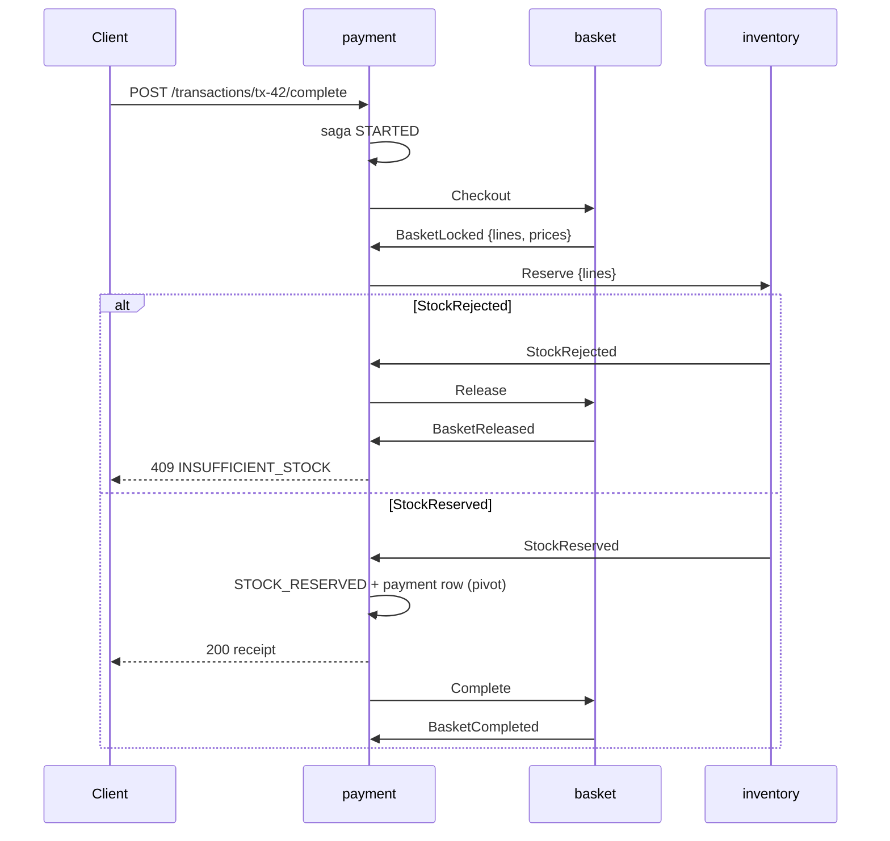

# Code walkthrough

Follow `POST /transactions/tx-42/complete`

<!--
[0:05]
Part two is the code.
I follow the completion of tx-42.
-->

---

# Entry point: from HTTP to payment-service

<div class="grid grid-cols-[2fr_3fr] gap-5">
<div>

<div class="head c-blue flex items-center gap-2 font-bold mb-2"><tabler-route class="icon" /> Gateway routes by path only</div>

```rust
match segments.as_slice() {
  ["items"] | ["inventory", ..] => inventory,
  ["transactions", _, "complete"] => payment,
  ["transactions"] | ["transactions", _]
    | ["transactions", _, "items"] => basket,
  ["analytics", ..] => analytics,
  _ => None, // 404, also for /internal/*
}
```
<span class="src">gateway/src/lib.rs:35-46</span>

<div v-click="1" class="insight mt-4 small">
  <div class="cue c-blue"><tabler-arrow-right class="icon" /> tx-42</div>
  <div><code>…/complete</code> goes to <b>payment</b> (port 8083)</div>
</div>

</div>
<div>

<div class="head c-blue flex items-center gap-2 font-bold mb-2"><tabler-player-play class="icon" /> payment-service <code>main</code></div>

```rust {3-4|5-6|7-9|10|11-13}{lines:false}
#[tokio::main]
async fn main() -> Result<(), Box<dyn Error>> {
    let store = Store::open(&db, reset)?;
    let bus = Bus::connect(kafka, "checkout", 30s).await?;
    let payment = Arc::new(Payment::new(store, bus, 10s));
    payment.recover(true).await?;       // sagas of a previous run
    let consumer = spawn_consumer(payment.clone()).await?;
    let recovery = spawn_recovery(payment.clone(), 1s);
    // consumer has joined its group: ready
    serve(NAME, 8083, router(payment.clone())).await?;
    recovery.abort();
    consumer.abort();
    bus.flush().await?;                 // deliver queued records
}
```
<span class="src">payment-service/src/main.rs:5-48 (trimmed)</span>

</div>
</div>

<!--
[0:50]
Execution starts at the gateway.
The gateway matches the path.
The complete request goes to payment on port 8083.
Any other path, for example an internal path, gets 404.
Now look at the main function of payment.
First, it opens its SQLite file and connects to Kafka.
Bus connect also makes the six topics if they do not exist.
Next, it runs recovery for all unfinished sagas.
At startup, no request is in flight, so these sagas come from a previous run.
Then it starts the consumer and a recovery timer.
Last, it serves HTTP.
At shutdown, it flushes both producers, so no queued record is lost.
-->

---

# Request-reply over events

```rust {3|4-6|7-10|11-14}{lines:false}
pub async fn complete(&self, transaction: &str) -> Result<Value> {
    let tx = format!("tx-{}", parse_transaction_id(transaction)?);
    let id = self.db(move |s| s.start(&tx)).await?;            // saga STARTED
    let (sender, outcome) = oneshot::channel();
    self.waiters.lock()?.insert(id, sender);                    // correlation by saga id
    let _waiting = Waiting(&self.waiters, id);                  // Drop removes the waiter
    let saga = self.db(move |s| s.get(id)).await?;
    if self.bus.send(&checkout(&saga))?.await.is_err() {        // Checkout -> basket.commands
        return Err(Error::unavailable("The event broker is unavailable"));
    }
    match tokio::time::timeout(self.timeout, outcome).await {   // 10 s
        Ok(Ok(outcome)) => outcome,                             // receipt or rejection
        _ => Err(Error::unavailable("The checkout did not finish in time")),
    }
}
```
<span class="src">payment-service/src/lib.rs:152-179 (trimmed)</span>

<div class="insight mt-3 small">
  <div class="cue c-purple"><tabler-arrows-left-right class="icon" /> Sync over async</div>
  <div>The client API is synchronous, but the saga is asynchronous. The consumer task calls <code>answer(id, outcome)</code>, which sends on the <code>oneshot</code> channel.</div>
</div>

<!--
[0:50]
The client API is synchronous.
The client waits for a receipt.
But the saga is asynchronous.
This function joins the two worlds.
First, it writes the saga row with the state STARTED.
Next, it puts a oneshot sender in a waiter map.
The saga id is the correlation id.
A drop guard removes the waiter when the request ends, in all cases.
Then it publishes the Checkout command.
Last, it waits for the outcome, for a maximum of ten seconds.
The consumer task completes the waiter with a receipt or with an error.
If the time ends first, the client gets 503, and recovery finishes the saga later.
-->

---

# The checkout saga



<div
  v-motion
  :initial="{ opacity: 0, x: 40 }"
  :enter="{ opacity: 1, x: 0, transition: { delay: 300, duration: 500 } }"
  class="absolute right-10 top-28 w-64 flex flex-col gap-3 small"
>
  <div class="panel orange"><div class="head c-orange"><tabler-stack-2 class="icon" /> One record</div>Every arrow between services is one Kafka record. Each step is one local SQLite transaction.</div>
  <div class="panel purple"><div class="head c-purple"><tabler-flag class="icon" /> Pivot</div>After the payment row, the saga only rolls forward. Thus, the client gets the receipt there.</div>
</div>

<!--
[0:40]
This is the saga for tx-42.
Every arrow between two services is one Kafka record.
Payment sends Checkout, and basket locks the basket.
Then payment sends Reserve, and inventory reserves all lines or none.
If the stock is not sufficient, payment sends Release, and the client gets 409.
If the stock is reserved, payment records the payment.
This step is the pivot.
After the pivot, the saga cannot go back.
Thus, the client gets the receipt at the pivot.
Basket completes a few milliseconds later.
-->

---

# Try it: saga state machine

<SagaStepper />

<!--
[0:50]
This simulator shows the same saga as a state machine.
I select a scenario and step through it.
In the happy path, the saga goes from STARTED to BASKET_LOCKED, then to STOCK_RESERVED, and then to COMPLETED.
Look at the client column.
The receipt comes at STOCK_RESERVED, not at COMPLETED.
Now I select inventory down.
The saga stops in BASKET_LOCKED.
After the ten-second timeout, the client gets 503.
Then recovery moves the saga to COMPENSATING and sends Cancel.
When inventory is back, it applies Reserve and then Cancel, in order.
Then the saga goes to RELEASING and to ABORTED.
Last, I click redeliver.
The same reply arrives again, and zero rows change.
-->

---

# State pattern with compare-and-set

<div class="grid grid-cols-[3fr_2fr] gap-4">
<div>

```rust {2-3|4-8|9-10|11-12|13|14}{lines:false}
let next = match (saga.state.as_str(), event.kind()) {
  ("STARTED", "BasketLocked") =>
    db(locked(id))?.then(|| reserve(&saga)),
  ("BASKET_LOCKED", "StockReserved") => {
    if !db(reserved(id, amount))? { return Ok(vec![]) }
    self.answer(id, Ok(receipt(..)));        // pivot
    Some(complete(&saga, &paid_at))
  }
  ("BASKET_LOCKED", "StockRejected") =>
    db(releasing(id))?.then(|| release(&saga)),
  ("COMPENSATING", "ReservationCancelled") =>
    db(releasing(id))?.then(|| release(&saga)),
  ("RELEASING", "BasketReleased") => { db(aborted(id))?; answer(Err) }
  _ => None,                     // stale or duplicate reply
};
```
<span class="src">payment-service/src/lib.rs:198-262 (trimmed)</span>

</div>
<div>

```sql
-- every transition
UPDATE sagas
SET state = ?3, updated_at = ?4
WHERE id = ?1 AND state = ?2;
-- changed == 1 ?
```
<span class="src">payment-service/src/store.rs:135-162</span>

<div class="small mt-3">

<v-clicks>

- The pair `(state, event)` selects the step.
- A transition happens only from the expected state.
- The pivot updates the state and inserts the payment row **in one transaction**.
- The next command goes out only if the update changed 1 row.

</v-clicks>

</div>
</div>
</div>

<!--
[1:00]
This is the core of payment.
The pair of saga state and event type selects the next step.
For example, STARTED plus BasketLocked moves the saga to BASKET_LOCKED and sends Reserve.
BASKET_LOCKED plus StockReserved is the pivot.
It records the payment, answers the client, and sends Complete.
Every transition is a compare-and-set in SQL.
The update has the expected state in its WHERE clause.
If a reply is a duplicate, the state is already different.
Thus, the update changes zero rows, and payment sends no command.
Any other pair is stale, and payment ignores it.
-->

---

# Event bus: ordered per key, parallel across keys

<div class="grid grid-cols-[3fr_2fr] gap-4">
<div>

````md magic-move {lines: false}
```rust
// v1 · one record at a time
loop {
  let delivery = consumer.recv().await?;
  let replies = loop {                          // infra error: retry
    match handle(record).await {
      Ok(r) => break r, Err(_) => sleep(200ms) }
  };
  for r in replies { bus.send(r)?.await? }      // wait for Kafka
  consumer.store_offset(&delivery)?;            // then the offset
}
```

```rust
// v2 · per-key order, parallel keys
loop {
  let delivery = consumer.recv().await?;
  let slot = slots.acquire_owned().await?;       // max 64
  let (finished, done) = oneshot::channel();
  let before = previous.insert((topic, key), done);
  tokio::spawn(async move {
    if let Some(before) = before { before.await } // same key: wait
    let replies = loop {                          // infra error: retry
      match handle(record).await {
        Ok(r) => break r, Err(_) => sleep(200ms) }
    };
    finished.send(());                            // next same-key task
    drop(slot);
  });
}
```

```rust
// v3 · submitted: offsets after replies
loop {
  let delivery = consumer.recv().await?;
  let slot = slots.acquire_owned().await?;       // max 64
  let (finished, done) = oneshot::channel();
  let before = previous.insert((topic, key), done);
  let handled = tokio::spawn(async move {
    if let Some(before) = before { before.await } // same key: wait
    let replies = loop {                          // infra error: retry
      match handle(record).await {
        Ok(r) => break r, Err(_) => sleep(200ms) }
    };
    let sent = replies.map(|r| bus.send(r));      // enqueue in order
    finished.send(());                            // next same-key task
    drop(slot); sent
  });
  acks.send((delivery, handled)); // acker: offsets in topic order
}
```
````
<span class="src">service-kit/src/bus.rs:431-519 (v3 trimmed; v1 and v2 simplified)</span>

</div>
<div class="small flex flex-col gap-2 bus-notes">
  <div class="panel dim">
    <div class="head"><tabler-hourglass class="icon c-red" /> v1 · sequential</div>
    A command waits behind about 100 stations of scans.
  </div>
  <div v-click="1" class="panel blue">
    <div class="head c-blue"><tabler-arrows-split class="icon" /> v2 · per key</div>
    Same key → in order. Other keys → parallel (max 64).
  </div>
  <div v-click="2" class="panel orange">
    <div class="head c-orange"><tabler-checks class="icon" /> v3 · offset after replies</div>
    The acker awaits every reply from Kafka, then calls <code>store_offset</code>. A crash before that point → <b>redelivery</b>.
  </div>
  <div v-click="3" class="panel purple">
    <div class="head c-purple"><tabler-template class="icon" /> Template + Strategy</div>
    <code>run</code> owns the delivery rules. Each service gives only its <code>handle</code> closure.
  </div>
</div>
</div>

<style>
.bus-notes .panel {
  padding: 0.5rem 0.75rem;
  font-size: 0.76rem;
  color: var(--text-2);
}
.bus-notes .head {
  font-size: 0.92rem;
  margin-bottom: 0.15rem;
}
</style>

<!--
[1:10]
All three consumers use this one function, bus run.
The first version handled one record at a time.
A command waited behind about 100 stations of scans.
The second version keeps order only per key.
It takes a slot from a semaphore, so a maximum of 64 records run at the same time.
A new task with the same key waits for the previous task with that key.
Thus, the commands of one saga stay in order, and different keys run in parallel.
The submitted version adds an acker task.
The acker waits for each reply to reach Kafka.
Only then does it store the offset, in topic order.
If the service crashes before this point, Kafka delivers the record again.
The function is a template.
Each service gives only its handle function, as a strategy.
-->

---

# Error handling and edge cases

<div class="grid grid-cols-[2fr_3fr] gap-5">
<div>

<div class="head c-orange flex items-center gap-2 font-bold mb-2"><tabler-git-fork class="icon" /> Business refusal or failure?</div>

```rust
fn reject(error: Error, reply: impl FnOnce(Error) -> Value)
    -> Result<Value> {
    if error.is_rejection() {   // 400, 404, 409
        Ok(reply(error))        // -> *Rejected event
    } else {
        Err(error)              // -> bus::run retries
    }
}
```
<span class="src">basket-service/src/lib.rs:292-298</span>

<div class="grid grid-cols-2 gap-2 mt-3 small">
  <div v-click class="panel red"><div class="head c-red"><tabler-x class="icon" /> Refusal</div>Final. It becomes a <code>*Rejected</code> reply.</div>
  <div v-click class="panel orange"><div class="head c-orange"><tabler-refresh class="icon" /> Failure</div>Temporary. The bus tries the record again.</div>
</div>
</div>
<div class="compact" style="font-size: 0.74rem">

| Case | Mechanism | Client sees |
| --- | --- | --- |
| Duplicate command | replay gives the same reply | same result |
| Late Reserve after Cancel | tombstone row refuses it | — |
| Scan races completion | basket is CHECKING_OUT | <span class="c-red">409</span> TRANSACTION_NOT_OPEN |
| inventory down | recovery: Cancel, then Release | <span class="c-red">503</span> after 10 s |
| basket down after pivot | recovery sends Complete again | <span class="c-green">200 receipt</span> |
| payment crash mid-saga | redelivery + startup recovery | dropped connection |
| Kafka consume error | rejoin the consumer group | — |

</div>
</div>

<!--
[1:10]
The code has two classes of errors.
A business refusal, for example insufficient stock, is final.
The handler turns it into a rejection event, and the client gets the same 409 as before.
An infrastructure failure, for example a database error, is temporary.
The handler returns an error, and the bus tries the same record again.
The table shows the edge cases.
Duplicate commands return the same result.
A Reserve that arrives after its Cancel finds a tombstone, so it cannot take stock.
A scan that races a completion finds the basket in CHECKING_OUT and gets 409.
If inventory is down, the client gets 503 after ten seconds.
Recovery then sends Cancel. When inventory is back, the stock returns and the basket opens again.
If basket is down after the pivot, the client still gets the receipt.
-->

---
transition: view-transition
---

# Popular items · 1 · From scan to analytics {.vt-popular}

<div class="grid grid-cols-[3fr_2fr] gap-5">
<div>

```rust {2|3-4|5-6|7|all}{lines:false}
pub fn scan(&self, id: i64, sku: &str) -> Result<..> {
  self.db.write(|c| {            // one local transaction
    if basket(c, id)?.status != "OPEN" { return Err(not_open()) }
    let item = select_catalog(c, sku)?;   // local replica
    upsert_line(c, id, &item)?;            // quantity + 1
    add_to_total(c, id, item.cents)?;
    insert("scan_events(sku, name)")?;    // outbox row
    Ok((basket(c, id)?, item))
  })
}
```
<span class="src">basket-service/src/store.rs:91-120 (trimmed)</span>

</div>
<div v-click class="small">

<div>

- `scan_events.sequence` is `AUTOINCREMENT`: no gaps, commit order. It is the **global scan number**.
- The client gets 200 right after the commit.
- The relay sends in order. A failed delivery **rewinds** to the last confirmed sequence.
- After a restart, the relay resumes from the **last sequence in the topic**.

</div>

</div>
</div>

<div
  v-motion
  :initial="{ opacity: 0, y: 30 }"
  :enter="{ opacity: 1, y: 0, transition: { delay: 250, duration: 500 } }"
  class="mt-3"
>
  <ScanPipeline />
</div>

<!--
[0:50]
Now the specific case: the popular-items window.
It starts with a scan of tx-42.
Basket checks that the basket is open and finds the SKU in its local catalog.
It adds the line and writes one outbox row, in the same transaction.
The outbox sequence has no gaps and follows the commit order.
This sequence is the global scan number.
Basket answers the client right after the commit.
A relay task reads the outbox in order and publishes each row to the scan topic.
If a delivery fails, the relay goes back to the last confirmed sequence.
Analytics consumes the topic in batches of up to 5,000 events.
-->

---
transition: view-transition
---

# Popular items · 2 · Hopping window {.vt-popular}

<div class="flex gap-2 mb-3 small formulas">
  <span class="badge c-blue">end = last / slide × slide</span>
  <span class="badge c-blue">start = max(end − size + 1, 1)</span>
  <span class="badge c-text2">trim seq ≤ end − size</span>
  <span class="badge fill">size 1000 · slide 500</span>
</div>

<HoppingWindow />

<!--
[1:10]
The window counts scans, not seconds.
The defaults are a window size of 1000 and a slide of 500.
The window end is the last sequence, rounded down to a multiple of the slide.
The window start is the end minus the size, plus one.
I move the slider.
At sequence 1,499, the published window is still 1 to 1,000.
At sequence 1,500, a boundary is crossed.
Analytics publishes the window 501 to 1,500 and ranks the SKUs by count.
Scans at or below the end minus the size are not necessary any more, so analytics deletes them.
Now I inject a duplicate.
The cursor skips it.
Then I inject a gap.
The batch stops at the gap and waits until the relay sends the lost event again.
-->

---
transition: view-transition
---

# Popular items · 3 · Persistence and reads {.vt-popular}

<div class="grid grid-cols-[3fr_2fr] gap-4">
<div>

```rust {1|3-6|8|9-10|11-13|all}{lines:false}
self.db.write(|c| {                            // ONE transaction
  let mut last = cursor(c)?;
  for e in events {
    if e.sequence <= last { continue }         // duplicate: skip
    if e.sequence != last + 1 { break }        // gap: wait
    insert(e)?; last = e.sequence;
  }
  update_cursor(c, last)?;
  let end = last / slide * slide;
  if end <= published_end(c)? { return Ok((last, None)) }
  let top = rank(c, (end - size + 1).max(1), end)?;  // GROUP BY sku
  save_snapshot(c, &top)?;
  delete_scans_up_to(c, end - size)?;          // trim
})
```
<span class="src">analytics-service/src/store.rs:111-165 (trimmed)</span>

</div>
<div class="small">

<v-clicks>

- Scans, cursor, snapshot, and trim **commit together**. A crash or a replay never counts a scan twice.
- The Kafka offset is stored **after** this commit (`consumer.done(last)`).
- **Read path:** `catch_up` reads the newest sequence in the topic, then waits for the cursor (max 5 s).
- Kafka down or slow → serve the **last snapshot** (degraded mode).
- Restart → snapshot and cursor load from SQLite. The consumer resumes from its offset.

</v-clicks>

</div>
</div>

<!--
[0:50]
This is the persistence of the window.
One SQLite transaction does all the work.
It skips duplicates and stops at a gap.
It moves the cursor.
If a boundary is crossed, it ranks the SKUs, saves the snapshot, and trims old scans.
Because all of this commits together, a replay never counts a scan twice.
The Kafka offset is stored only after this commit.
For a read, analytics first reads the newest sequence in the topic.
Then it waits until its cursor reaches that sequence.
If Kafka is down, it serves the last snapshot.
-->

---
hotkey: l
---

# Live demo: tx-42 through the gateway

<LiveDemo />

<!--
[1:00]
Now a live demo.
The services and Kafka run on my laptop.
The live transaction id is the next id in the database, not tx-42.
I start a transaction for station 7 and scan three items.
Each scan returns in a few milliseconds.
Then I complete the transaction.
The receipt comes back after the saga, in less than twenty milliseconds.
The status can still show OPEN, because Complete arrives at basket a few milliseconds later.
Next, I send 600 scans. The slide is 500, so the sequence crosses a window boundary.
Now the popular items show a new window. On a fresh database, it is 1 to 500.
The low-stock list includes the SKUs that the saga reserved.
If the gateway is not available, the panel shows a recorded run of the same steps.
-->
