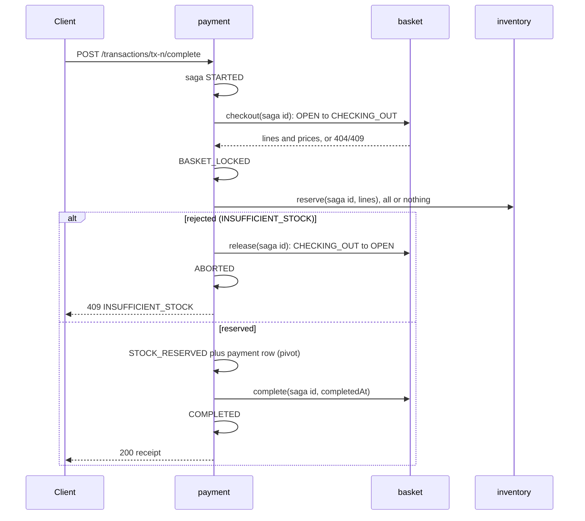

# Assignment 5 — Self-Checkout: Microservices (database per service)

The Assignment 4 services (inventory, basket, payment, analytics) are now
**independently deployable microservices**. Each one is its own Rust binary
and OS process, and each **owns a private SQLite database** that no other
service opens. Services share no data-access code and no tables; they talk only
through HTTP APIs. A routing-only API gateway keeps the unchanged load client
working.

Requests that must change several databases are coordinated in two ways:

- **Checkout uses an orchestrated saga.** payment-service drives basket,
  inventory, and its own database, with compensations and crash recovery.
- **Scans reach analytics through choreography.** basket-service writes each
  accepted scan to a transactional outbox, and analytics-service consumes
  the outbox as an event feed. Basket never calls analytics.

Submission directory: <https://github.com/SASUKE40/CS6510-2026/tree/main/microservices>

## Services

| # | Microservice | Port | Owns | Public routes (via gateway) | Internal routes (service to service) |
| - | --- | --- | --- | --- | --- |
| 1 | `inventory-service` | 8081 | `inventory.sqlite` | `GET /items`, `GET /inventory/low-stock` | `GET /internal/catalog`, `POST /internal/reservations`, `POST /internal/reservations/{id}/cancel` |
| 2 | `basket-service` | 8082 | `basket.sqlite` | `POST /transactions`, `POST /transactions/{id}/items`, `GET /transactions/{id}` | `POST /internal/baskets/{id}/checkout`, `/release`, `/complete`; `GET /internal/scan-events` |
| 3 | `payment-service` | 8083 | `payment.sqlite` | `POST /transactions/{id}/complete` | (none; it is the saga orchestrator) |
| 4 | `analytics-service` | 8084 | `analytics.sqlite` | `GET /analytics/popular-items` | (none; it consumes basket's feed) |

The API gateway (`checkout-gateway`, port 8080) routes each public path to
its owner and relays the response. It has no business logic and no database.
It does not route `/internal/...`, so outside clients get 404 there.

Each service creates, seeds, and validates its own schema at startup, and
takes its own `--reset=true`. The only shared crate is
[`service-kit`](service-kit/), a chassis library for HTTP error mapping, CLI
parsing, `/health`, graceful shutdown, SQLite connection handling (pragmas
and group-committed units of work), and the inter-service JSON client. It contains no schema
and no domain types. The Assignment 4 shared `checkout-data` library and the
`db-admin` tool are gone.

## Load-test reports (unchanged Java client)

- Default parameters (10 stations, 60 s):
  [`reports/default/report-20261019-204525.json`](reports/default/report-20261019-204525.json)
- Stress mode (`--stations=100 --duration=120`):
  [`reports/stress/report-20261019-204729.json`](reports/stress/report-20261019-204729.json)

These use the submitted configuration, where every write commits on its own
(`MAX_BATCH = 1`, see [Group commit](#group-commit)). Other runs are kept for
comparison under each mode (see Results):

- `group-commit-256/`: writers share commits, up to 256 per batch;
- `before-group-commit/`: the original one-transaction-per-write code;
- [`reports/stress/earlier-run/`](reports/stress/earlier-run/): an earlier
  stress run of that original code.

Each directory also contains `verification.txt` (cross-database invariant
checks), `failures.txt` (every client error accounted for), and `logs/` (one
log per process).

## Architecture

```text
                    load client (unchanged, --baseUrl=http://localhost:8080)
                                      │
                           ┌──────────▼──────────┐
                           │  checkout-gateway   │  public routes only
                           └──┬──────┬──────┬──┬─┘
       ┌──────────────────────┘      │      │  └─────────────────────┐
┌──────▼────────────┐ ┌──────────────▼──┐ ┌─▼─────────────────┐ ┌────▼──────────────┐
│ inventory-service │ │ basket-service  │ │ payment-service   │ │ analytics-service │
│                   │◄┤ catalog replica │ │ saga orchestrator │ │                   │
│                   │ │ scan outbox     ├─┼───────────────────┼─► pulls scan feed  │
└──────┬────────────┘ └──────┬──────────┘ └──┬────────┬───────┘ └────┬──────────────┘
       │      ▲              │      ▲        │        │              │
       │      └── reserve / cancel ─┼────────┘        │              │
       │                     │      └── checkout / release / complete│
┌──────▼─────────┐  ┌────────▼─────┐   ┌──────────────▼┐  ┌──────────▼───────┐
│inventory.sqlite│  │basket.sqlite │   │payment.sqlite │  │analytics.sqlite  │
└────────────────┘  └──────────────┘   └───────────────┘  └──────────────────┘
```

### Data ownership

| Database | Tables | Written by | Shared with others only via |
| --- | --- | --- | --- |
| `inventory.sqlite` | `settings`, `items`, `stock_changes`, `reservations`, `reservation_lines` | inventory | `/items`, `/internal/catalog`, reservation API |
| `basket.sqlite` | `catalog` (replica), `transactions`, `lines`, `released_sagas`, `scan_events` (outbox) | basket | basket API, `/internal/scan-events` |
| `payment.sqlite` | `sagas` (saga log), `payments` | payment | receipt in the `/complete` response |
| `analytics.sqlite` | `settings`, `scans`, `cursor`, `popularity` | analytics | `/analytics/popular-items` |

Settings now belong to the service that uses them. Inventory owns the catalog
size, stock, and threshold. Analytics owns the window size and slide interval.
Each service refuses to reopen its database with different settings unless
started with `--reset=true`.

## Coordinating updates across databases

Without a shared database there is no single transaction to rely on. Each step
below is one **local** ACID transaction in one service's database. The
cross-service guarantees come from idempotent steps, persisted saga state, and
compensations.

### Checkout: orchestrated saga in payment-service

`POST /transactions/{id}/complete` is still synchronous. payment-service
writes each saga state to `payment.sqlite` before moving on.



- **Locking the basket replaces the shared-database write lock.** A scan
  that arrives while the basket is `CHECKING_OUT` gets
  `409 TRANSACTION_NOT_OPEN`. Of two racing completions, only one wins the
  conditional `OPEN -> CHECKING_OUT` update. Clients still see `OPEN`
  during checkout, because the spec has no in-between state.
- **The last unit cannot be sold twice.** The reservation is one local
  transaction in inventory using `UPDATE ... SET stock=stock-q WHERE stock>=q`
  for every line. A shortage rolls back all of that reservation's lines.
- **Every step is idempotent and keyed by the saga id.** Checkout, release,
  and complete accept only the saga that holds the basket. A repeated
  reserve with the same id is answered without decrementing again, and cancel
  can be repeated safely. payment-service retries only when the outcome is
  unknown (timeout or connection failure). Business rejections are final.
- **Tombstones stop late duplicates.** A request that timed out on the
  caller's side can still run later. During development this happened: a
  timed-out checkout re-locked a basket after its saga had already released it.
  Now `release` records the saga in `released_sagas`, so a late checkout from
  that saga gets `409 SAGA_RELEASED`. `cancel` turns an unknown reservation
  id into a `CANCELLED` tombstone, so a late reserve gets
  `409 RESERVATION_CANCELLED`. If a reserve request was sent more than once
  and then rejected, the orchestrator also cancels it.
- **The pivot is the point of no return.** Recording the payment
  (`STOCK_RESERVED` plus the `payments` row) is one local transaction.
  Before it, failures roll back (cancel the reservation, release the basket).
  After it, the saga only rolls forward: payment always succeeds in this
  simulation, so the client gets its receipt even if basket's final
  `complete` has to be retried later.
- **Recovery.** At startup, and every second for sagas older than 5 s,
  payment-service settles unfinished sagas. `STOCK_RESERVED` rolls forward
  to `COMPLETED`. `STARTED` and `BASKET_LOCKED` roll back to `ABORTED`.
  An in-memory set of active sagas keeps recovery away from requests still
  in flight.

| Failure | Client sees | Final state |
| --- | --- | --- |
| Empty basket, not open, unknown id | 409 / 404 from basket, relayed | saga `ABORTED`; nothing changed |
| A line short of stock | 409 `INSUFFICIENT_STOCK` | basket released (`OPEN`), no stock change, saga `ABORTED` |
| Inventory unreachable during reserve | 503 `SERVICE_UNAVAILABLE` | basket held until inventory returns; recovery cancels (tombstone) and releases |
| Basket unreachable at checkout | 503 | recovery releases the basket if it was locked |
| Basket unreachable after the pivot | 200 receipt | recovery completes the basket |
| payment-service crashes mid-saga | client times out | startup recovery rolls forward or back |

### Scan to analytics: choreography through a transactional outbox

- basket-service appends to `scan_events` **in the same local transaction**
  as the basket line, so an event exists exactly when a scan is accepted. The
  `AUTOINCREMENT` sequence is gap-free and in commit order, so it serves as the
  global scan number that hopping windows are defined on. Each event carries
  the item name, so analytics needs no catalog lookup.
- analytics-service pulls `GET /internal/scan-events?after=<cursor>` every
  100 ms and also before answering `/analytics/popular-items`. Every
  acknowledged scan is committed in the outbox, so answers are never stale.
  It inserts events and advances its `cursor` in one local transaction, which
  makes consumption idempotent; a gap in the feed is an error. The hop
  publishing and scan trimming are the same as in Assignment 4.
- Analytics is independent of basket's availability. If basket is down,
  analytics serves its last snapshot, then catches up from its cursor.

### Catalog replica

The SKU catalog never changes after seeding. basket-service copies it from
`GET /internal/catalog` at startup, retrying for up to 30 s on first start,
into its own `catalog` table. Scans therefore validate SKUs and prices with
no synchronous call to inventory on the hot path.

### Group commit

Each service writes through one SQLite connection
([`service-kit/src/sqlite.rs`](service-kit/src/sqlite.rs)), and every commit
waits for an `fsync`. `Database::write` can group-commit:

- each unit of work runs in its own savepoint inside a shared transaction,
  and a unit that fails rolls back only its savepoint;
- the writer that finds no other writers queued, or that fills the batch to
  `MAX_BATCH`, commits for the whole batch, so one `fsync` makes every unit
  in it durable;
- no caller gets its result before that commit returns;
- if the commit fails, every unit in the batch gets the error;
- readers use a separate connection and only see committed data.

The submitted configuration sets `MAX_BATCH = 1`, so every unit commits and
syncs on its own, exactly as Assignment 4 commits each request. This keeps
the comparison with Assignment 4 about the architecture rather than the
commit path. Raising `MAX_BATCH` turns sharing on, with the same per-request
durability. Results for 256 are below.

## Results and comparison

Same laptop as earlier assignments: Rust 1.98.0 release build, Temurin JDK
21.0.12, ARM64 macOS 27.0. Every database uses WAL and `synchronous=FULL`.
Each workload starts from freshly reset databases (2,000 SKUs × 10,000 units).

| Run | Scans/s | Completed tx/s | Scan p50 / p95 / p99 (ms) | Complete p95 / p99 (ms) | Errors |
| --- | --- | --- | --- | --- | --- |
| **Default (10 × 60 s)** | **5,488.0** | **258.2** | **1.16 / 2.14 / 3.21** | **11.80 / 18.32** | 15,742 × 409 `INSUFFICIENT_STOCK` |
| **Stress (100 × 120 s)** | **4,092.0** | **166.9** | **13.85 / 37.75 / 98.29** | **82.23 / 221.94** | 26,832 × 409 `INSUFFICIENT_STOCK` |
| Default, `MAX_BATCH = 256` | 8,757.3 | 348.2 | 0.70 / 1.10 / 1.69 | 9.60 / 13.35 | 29,103 × 409 `INSUFFICIENT_STOCK` |
| Stress, `MAX_BATCH = 256` | 11,177.5 | 304.3 | 5.74 / 11.27 / 24.53 | 33.28 / 78.33 | 91,280 × 409 `INSUFFICIENT_STOCK` |
| Default, original per-write code | 3,627.0 | 201.2 | 1.18 / 2.49 / 16.17 | 9.08 / 44.39 | 8,621 × 409 `INSUFFICIENT_STOCK` |
| Stress, original per-write code | 4,646.3 | 179.6 | 11.73 / 31.05 / 77.67 | 56.58 / 155.97 | 31,796 × 409 `INSUFFICIENT_STOCK` |
| Stress, original per-write code, earlier run | 3,167.8 | 143.8 | 11.73 / 44.21 / 216.49 | 91.27 / 604.19 | 18,950 × 409 `INSUFFICIENT_STOCK` |
| *A4 service-based, default* | *5,200.3* | *252.2* | *1.30 / 3.08 / 4.72* | *6.66 / 9.44* | *same cause* |
| *A4 service-based, stress* | *5,042.6* | *185.9* | *16.96 / 36.11 / 56.22* | *7.35 / 11.86* | *same cause* |

- **Correctness held without a shared database.** After every run, a
  read-only check of all four stopped databases passed
  ([`scripts/verify_database.py`](scripts/verify_database.py)):
  - integrity and foreign keys in each database;
  - inventory conservation for all 2,000 SKUs;
  - no basket left `CHECKING_OUT` and no unfinished saga;
  - completed baskets = completed sagas = active reservations = payments,
    per SKU and in cents;
  - catalog replica = inventory catalog;
  - outbox sequence = accepted scans = analytics cursor;
  - the published window matches the outbox and the client's top 10.

  The only errors were whole-basket stock rejections after popular SKUs sold
  out, as in Assignments 1–4. There were no transport errors, 5xx responses,
  or saga retries.
- **With the same commit path, throughput is close to Assignment 4.** Both
  commit and sync once per write. Scan throughput was:
  - 5,488 scans/s at default load (A4: 5,200, +6%);
  - 4,092 scans/s under stress (A4: 5,043, −19%).

  Rejection rates were also similar: 50% of completions at default load
  (A4: 49%) and 57% under stress (A4: 61%).
- **Typical scans are faster; the tail is worse.** Basket no longer shares a
  write lock with payment and analytics. Its database holds only its own
  data, and reads use a separate WAL reader connection. Median scan latency:
  - 13.9 ms under stress against 17.0 ms;
  - 1.16 ms at default load against 1.30 ms.

  Under stress the scan p99 is 98 ms against 56 ms, and the worst request
  took 3.8 s.
- **Durable commits are the bottleneck.** In Assignment 4, a successful
  completion was one commit in one file. Here it is seven durable commits
  across three files: saga start, basket lock, saga state, reservation,
  pivot, basket complete, and saga complete. A rejected completion takes
  five. Four processes syncing to the same SSD make basket commits
  occasionally wait a long time, and every scan queued behind them waits
  too. A diagnostic run with `synchronous=NORMAL` (no sync per commit, not
  submitted) reached 8,516 scans/s, which confirmed the cause. Two earlier
  changes reduce the cost: payment's saga rows are small (receipt derived,
  basket stored once, an index that does not change on every update), and
  the 5 s call timeout avoids duplicate requests on slow replies.
- **Completion pays for its hops.** Completion p50 is 32 ms against 2.4 ms
  in Assignment 4 at 100 stations, and 4.7 vs 2.3 ms at 10. After the
  gateway hop, payment makes three sequential calls to other services and
  four local commits, each waiting for its own durable sync. Completion p99
  is 222 ms against 12 ms. This is the main cost of coordinating separate
  databases.
- **Group commit removes the bottleneck when enabled.** With
  `MAX_BATCH = 256` and `synchronous=FULL` kept:
  - stress reached 11,178 scans/s, 2.2× Assignment 4;
  - default load reached 8,757 scans/s, 1.7× Assignment 4;
  - stress scan p99 fell to 24.5 ms.

  Batches stayed small: about 13–16 units at basket and 2–3 at inventory
  and payment. In 30-second stress experiments, a cap of 4 already roughly
  doubled throughput over a cap of 1. Caps of 16 and above could not be
  told apart within run-to-run noise. This lead does not come from the
  architecture, since group commit would speed up Assignment 4's single
  database too, which is why it is not the submitted configuration. More
  transactions complete with it, so popular SKUs sell out sooner and more
  baskets are rejected (58% and 71%).
- **Single runs are noisy.** At default load, the original per-write code
  and the submitted `MAX_BATCH = 1` code commit the same way, yet they ran
  at 3,627 and 5,488 scans/s. The two stress runs of the original code
  differed by about 45% (3,168 vs 4,646). Throughput depends on how the
  laptop's SSD handles bursts of concurrent syncs.
- **Trade-offs.** Each service now fails, restarts, scales, and migrates its
  schema on its own:
  - analytics keeps answering while basket is down;
  - a schema change in inventory touches only inventory;
  - the catalog is replicated, so scans do not depend on inventory.

  The costs:
  - every cross-service invariant needs an explicit protocol (saga,
    idempotency keys, tombstones, recovery, outbox cursor);
  - data is eventually consistent between services (a basket stays held
    until inventory returns);
  - completions are slower;
  - durability is paid in every service a request touches, so the commit
    path decides throughput.

## Build, test, and run

From the repository root, with stable Rust installed:

```bash
./microservices/run.sh --reset     # build, reset every service's DB, start all 5 processes
```

The API is then at <http://localhost:8080> (docs at `/docs`). Ctrl+C stops every
process gracefully. Without `--reset`, each service keeps its data. Every
deployable can also be started on its own; only the URLs of the services it
calls are needed:

```bash
cargo build --release --locked --manifest-path microservices/Cargo.toml
B=microservices/target/release D=microservices/data/dev; mkdir -p $D
$B/inventory-service --db=$D/inventory.sqlite --port=8081 &
$B/basket-service    --db=$D/basket.sqlite    --port=8082 --inventory=http://127.0.0.1:8081 &
$B/payment-service   --db=$D/payment.sqlite   --port=8083 --basket=http://127.0.0.1:8082 --inventory=http://127.0.0.1:8081 &
$B/analytics-service --db=$D/analytics.sqlite --port=8084 --basket=http://127.0.0.1:8082 &
$B/checkout-gateway  --port=8080              # --inventory=URL --basket=URL ... to relocate services
```

Tests and the load-test reproduction (requires JDK 21+, Python 3, and curl; ports
8080–8084 must be free, or override them with `CHECKOUT_PORT`, `INVENTORY_PORT`,
`BASKET_PORT`, `PAYMENT_PORT`, `ANALYTICS_PORT`):

```bash
cargo test --locked --manifest-path microservices/Cargo.toml
cargo clippy --locked --manifest-path microservices/Cargo.toml --workspace --all-targets -- -D warnings
./microservices/load-tests.sh     # LOAD_MODES=stress to run one workload
```

A unit test in `service-kit` drives 16 concurrent writers through
`Database::write`, with every tenth unit failing. It checks that exactly the
successful units are committed. The 15 system tests give every service its own temporary database, start each
on an ephemeral port wired to the others by URL, and drive them through the
gateway over TCP. Eleven are carried over from Assignment 4:

- the API contract, validation, and 404/405 responses;
- last-unit and duplicate-completion races;
- whole-basket rollback across every service;
- hopping-window boundaries;
- scans racing completion;
- concurrent scans each counted exactly once;
- restart, per-service settings validation, and reset;
- analytics resuming from basket's feed, and the background refresher;
- gateway routing and the 502 response when a service is down.

Four are new:

- an inventory outage in the middle of a saga, compensated by recovery, with
  the late reserve refused by the tombstone;
- a restarted orchestrator that rolls forward after the pivot and back before
  it, with the late checkout refused;
- idempotency of every internal saga step and of the scan feed;
- analytics serving its last snapshot during a basket outage, then catching
  up exactly once.

The load-test script resets all four databases per workload, runs the
unchanged client, stops every process, then runs the cross-database verifier
and accounts for every client error.
